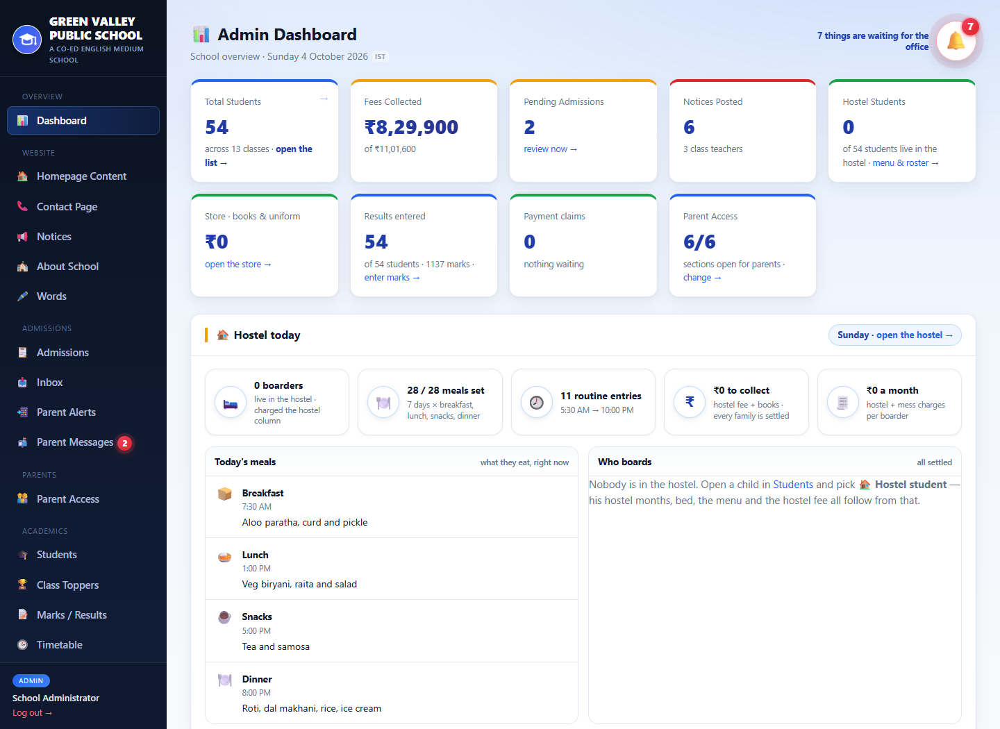
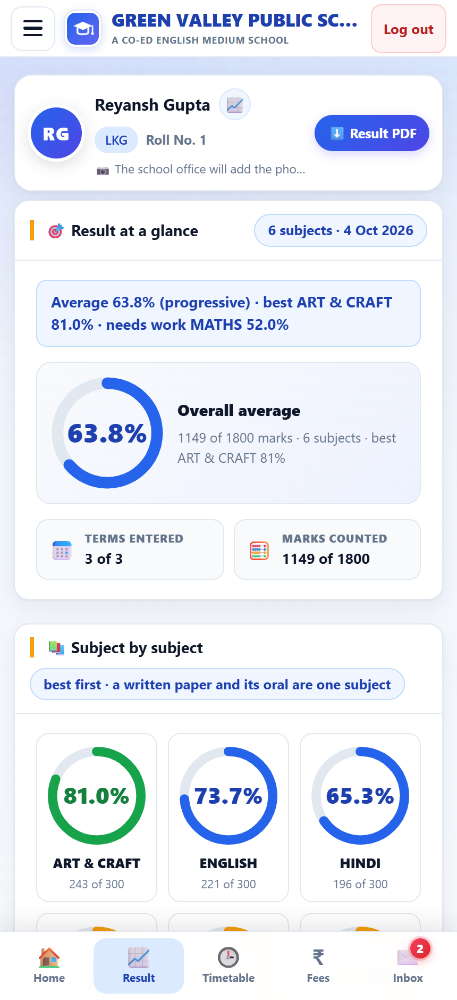
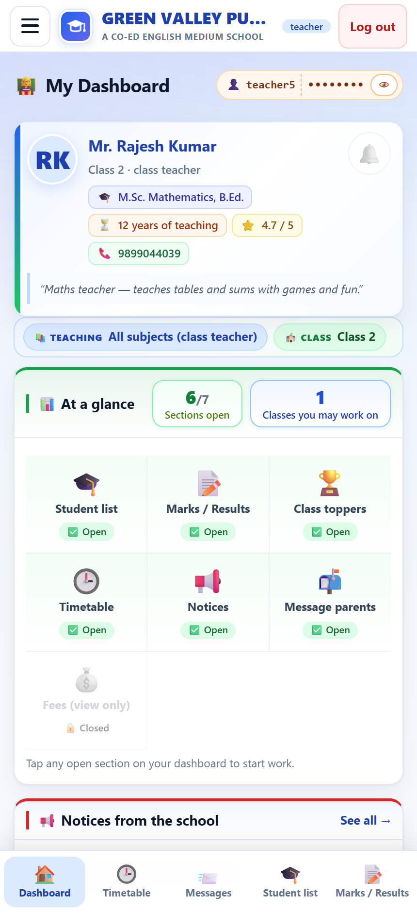

# 🎓 School Management Portal

[](https://github.com/Suraj-Kumar-Ray/school-portal/actions/workflows/ci.yml)
[](https://school-portal-demo-cgjm.onrender.com)


A complete school platform — a public website **plus** separate portals for the office, teachers
and parents — built with **Node.js, Express, EJS and SQLite**.

> **Try it:** [school-portal-demo-cgjm.onrender.com](https://school-portal-demo-cgjm.onrender.com) — the free tier sleeps, so the first visit can take about a minute. Demo logins are under [Demo logins](#-demo-logins); the database reseeds itself on every deploy, so nothing you do in the demo is permanent.

> **This is a sanitised showcase build.** The school it was written for is a real one, but this
> repository ships **only fictional demo data** (see [Demo data](#-demo-data)). No student, parent
> or staff record, no photograph and no contact detail from the original deployment is included.
> Every image in `public/images/` is a generated placeholder.

<p align="center">
  
</p>

---

## ✨ What it does

Four applications in one codebase, one SQLite file, one `node server.js`.

| Area | What it covers |
|---|---|
| 🌐 **Public website** | Home with hero slides & posters, about, class-wise fee structure, hostel, teacher profiles, admission enquiry form with status tracking, contact |
| 🏛️ **Admin panel** | Dashboard, students & admissions, teacher access & permissions, marks / results, class toppers, timetable, fees & payment claims, hostel & mess, notices, store, parent access, site content editor |
| 👨‍👩‍👧 **Parent app** | One login for all of a parent's children — result & performance with charts, timetable, month-by-month fee status, UPI payment details, notices, messages to the office, phone alerts |
| 🧑‍🏫 **Teacher app** | Only the sections the office grants: student list, marks entry, toppers, timetable, notices, one message to a whole class |

<p align="center">
  
  
  
</p>

## 🧱 Tech stack

- **Runtime:** Node.js 18 + Express 4
- **Views:** server-rendered EJS (no client framework, no build step)
- **Database:** SQLite via `better-sqlite3` — one file, WAL mode, schema in [`db/schema.sql`](db/schema.sql)
- **Auth:** session-based, `bcryptjs` password hashing, role checks per route
- **Front end:** hand-written CSS and small vanilla JS modules (progress rings, save confirmation, alerts, service worker)
- **Extras:** printable result sheets & fee sheets (PDF via the browser), a PWA manifest + service worker, a free weather/clock strip on the sign-in screen (Open-Meteo, no API key)

## 🚀 Run it locally

```bash
npm install
npm run seed     # creates data/school.db and fills it with the fictional demo school
npm start        # http://localhost:3000
```

`npm run seed` deletes and rebuilds the database — safe here, because the data is generated.
On a host that wipes its disk (or a brand-new machine) `server.js` seeds automatically the first
time it boots with no database present.

## 🔑 Demo logins

| Role | Username | Password |
|---|---|---|
| Admin (the office) | `admin` | `admin123` |
| Teacher | `teacher1` … `teacher13` | `teacher123` |
| Parent | `parent1` … `parent52` | `parent123` |
| Parent with two children | `parentmulti` | `parent123` |

Students never sign in — a child's record is reached through the parent's login.

## ✅ Tests

```bash
npm run smoke      # boots the app, then drives the public site and every login over HTTP
```

`scripts/smoke.mjs` starts the real server (auto-seeded database), waits for `/healthz`, then
asserts that the home page renders, a wrong password returns **401**, and admin, parent and teacher
each sign in, land on their own home page and open it with the session cookie. It exits non-zero on
the first broken check, so CI runs exactly this file on every push — the green badge means the app
boots and signs users in, not just that the source parses.

## 🧪 Demo data

`db/seed.js` generates the whole fake school deterministically: 52 students across
LKG → Class 10, 13 teachers with profiles, a full class-wise fee sheet, subjects, exams, marks,
notices, timetables, bus routes and hostel meals. Names, phone numbers and addresses are invented;
`config.js` brands the demo school **“Green Valley Public School”**.

Point it at a real school by editing [`src/config.js`](src/config.js) — name, address, phones,
session, hostel details and all the default page copy live there — and by replacing the images in
`public/images/` and `public/icons/`.

## ☁️ Deploy

[`render.yaml`](render.yaml) describes the whole service for Render (free plan, seeds on boot).
A Dockerfile is also included for a persistent-disk deployment where the school's real database
lives on a mounted volume.

## 📁 Layout

```
server.js            boot: seed-if-empty, then listen
src/
  app.js             express wiring, view locals, health check
  config.js          ALL branding & default page copy
  db.js              sqlite connection + lightweight migrations
  routes/            auth · public · admin · parent · teacher
  services/          one file per domain (fees, marks, timetable, payments, weather…)
views/               EJS templates: public/ admin/ parent/ teacher/ partials/
db/                  schema.sql + seed.js
public/              css, js, icons, placeholder images
docs/screenshots/    the images in this README
```

## 📄 License

MIT — see [LICENSE](LICENSE).

---

Built by **Suraj Kumar** — full-stack developer (React.js · Node.js · SQL).
[Portfolio](https://suraj-portfolio-wjpt.onrender.com) · [GitHub](https://github.com/Suraj-Kumar-Ray)
